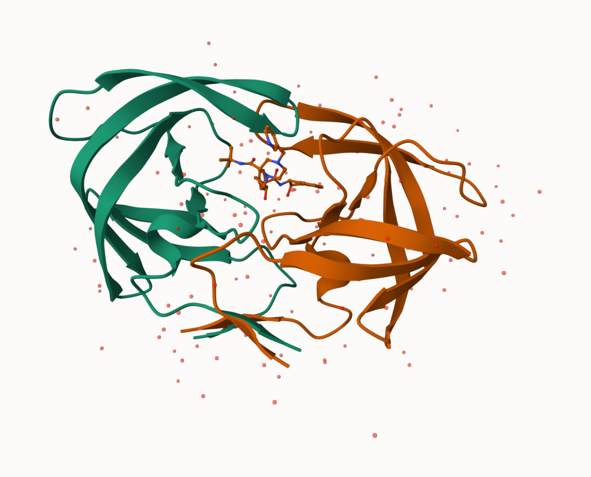
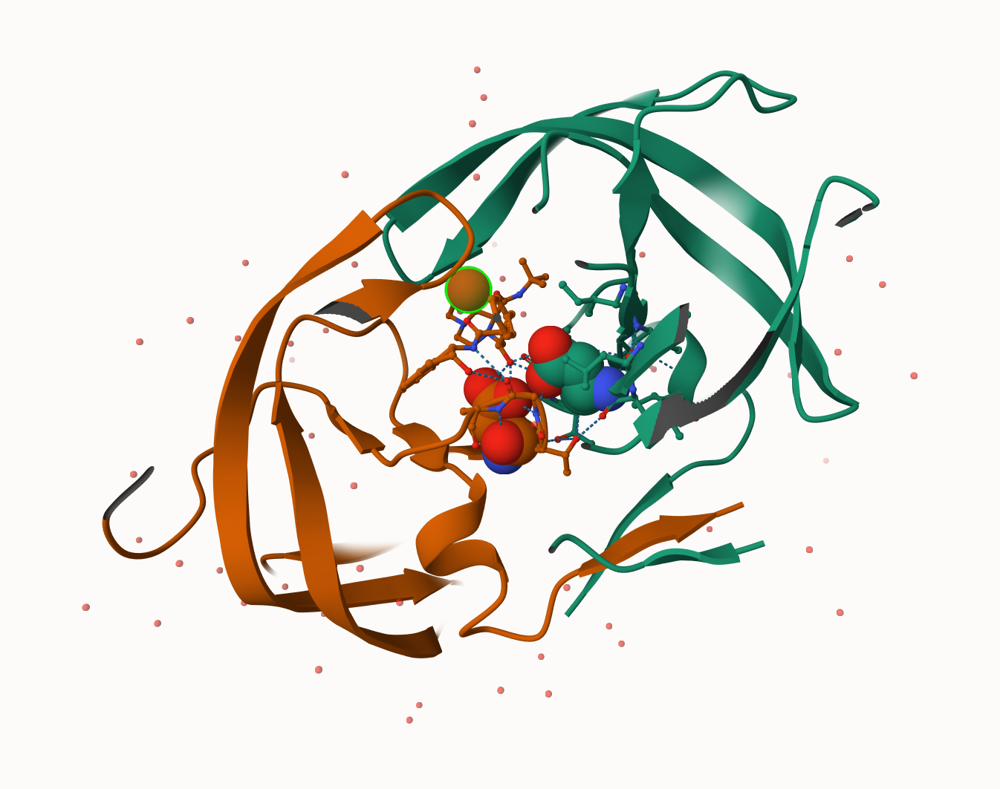
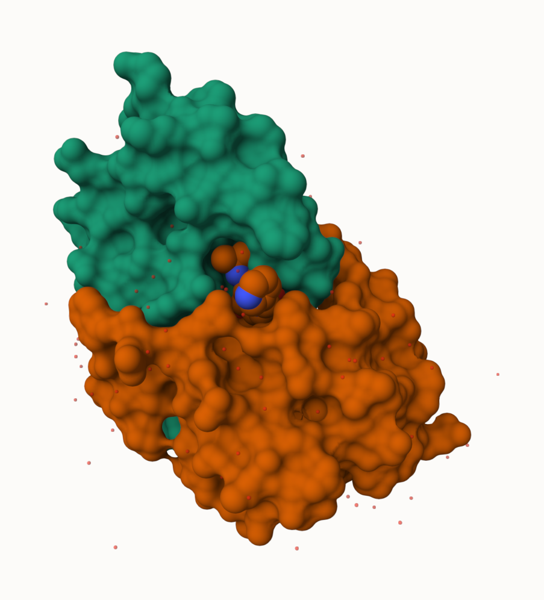

## Background

The [PDC database](https://www.rcsb.org/) is the main repository of biomolecular structure information. Let's have a look at the composition of this database:

Visit PDB and clock:
Analyze > PDB Statistics > Experimental Method > Summary

We can "scrape" data from this page with the **datapasta** package that we can install from CRAN `install.packages("datapasta")`

Then "Addins > Paste as data.frame":

```{r, echo = FALSE}
pdb <- data.frame(
  stringsAsFactors = FALSE,
       check.names = FALSE,
           Molecular.Type = c("Protein (only)",
                              "Protein/Oligosaccharide","Protein/NA",
                              "Nucleic acid (only)","Other","Oligosaccharide (only)",
                              "Total"),
            Xray = c(184731, 10716, 9341, 3216, 178, 11, 208193),
                EM = c(25754, 4037, 7520, 347, 27, 1, 37686),
               NMR = c(12904, 34, 288, 1599, 35, 6, 14866),
       Integrative = c(365L, 8L, 27L, 3L, 4L, 0L, 407L),
  Multiple.methods = c(232L, 11L, 8L, 15L, 0L, 1L, 267L),
           Neutron = c(86L, 1L, 0L, 3L, 0L, 0L, 90L),
             Other = c(32L, 0L, 0L, 1L, 0L, 4L, 37L),
             Total = c(224104, 14807, 17184, 5184, 244, 23, 261546)
       )
```


>Q1: What percentage of structures in the PDB are solved by X-Ray and Electron Microscopy.

```{r}
pdb [7,2:3] / pdb[7,9] * 100
```


>Q2: What proportion of structures in the PDB are protein?

```{r}

prot.ind <- pdb$Molecular.Type == "Protein (only)"
total.ind <- pdb$Molecular.Type == "Total"
pdb$Total[prot.ind] / pdb$Total[total.ind] * 100

```


>Q3: Type HIV in the PDB website search box on the home page and determine how many HIV-1 protease structures are in the current PDB? **skipped**

##The Mol-Star Viewer

This viewer is embeded into many newer bioinformatics databases including the PDB and UniProt. The viewer is also accessible from it's homepage: https://molstar.org 



HIV-Protease (or HIV-PR for short) is a critical HIV enzyme required for virus replication. It is an Asparatal protease, which means it uses Asp amino acid residues to cleave proteins.






>Q4: Water molecules normally have 3 atoms. Why do we see just one atom per water molecule in this structure?

We only see one atom per water molecule in this structure because this structure is a virus 

>Q5: There is a critical “conserved” water molecule in the binding site. Can you identify this water molecule? What residue number does this water molecule have

The water is HOH 308

>Q6: Generate and save a figure clearly showing the two distinct chains of HIV-protease along with the ligand. You might also consider showing the catalytic residues ASP 25 in each chain and the critical water (we recommend “Ball & Stick” for these side-chains). Add this figure to your Quarto document.
Discussion Topic: Can you think of a way in which indinavir, or even larger ligands and substrates, could enter the binding site?


## Bio3D in R

The **bio3d** package is for structural bioinformatics and allows us to read structural data and perform bioinformatics analysis all within R itself:

### Reading PDB file data into R

```{r}
library(bio3d)

hiv <- read.pdb("1hsg")
```

```{r}
hiv
```
>Q7: How many amino acid residues are there in this pdb object? 

```{r}
protein <- hiv$atom[hiv$atom$type == "ATOM", ]
length(unique(paste(protein$chain, protein$resno)))
```

>Q8: Name one of the two non-protein residues? 

```{r}
nonprotein <- hiv$atom[hiv$atom$type == "HETATM", ]
unique(nonprotein$resid)
```

>Q9: How many protein chains are in this structure? 

```{r}
length(unique(protein$chain))
```

```{r}
head(hiv$atom)
```

```{r}
pdbseq(hiv)
```

## Quick structure viz in  R

We can use the new *Bio3d.view* package to more easily view structures quickly in R:
```{r}
library(bio3dview)
```

```{r}
view.pdb(hiv)
```

```{r}
# Select our two ASP 25 amino acids
asp <- atom.select(hiv, resno=25)

## Draw then highlighted in Spacefill
view.pdb(hiv,
         highlight=asp,
         highlight.style="spacefill",
         backgroundColor = "pink")
```

## Predict the dynamics of ADK

Let's read a new PDB structure of Adenylate kinase and perform normal mode analysis
```{r}
adk <-  read.pdb("6s36")
m <-  nma(adk)
plot(m)
```

Also make a little molecular movie (trajectory) for viewing in mol star

```{r}
mktrj(m, file="adk_dynamics.pdb")
```

```{r}
view.nma(m)
```

