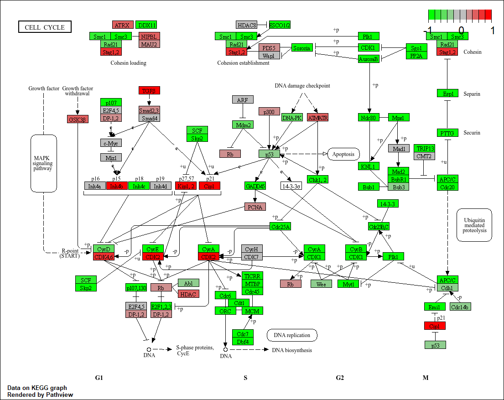
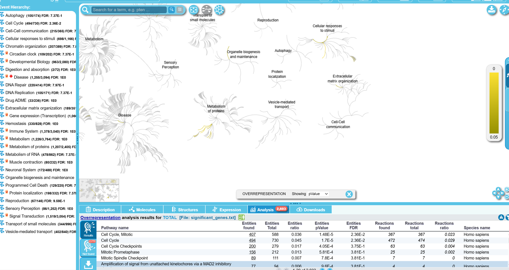
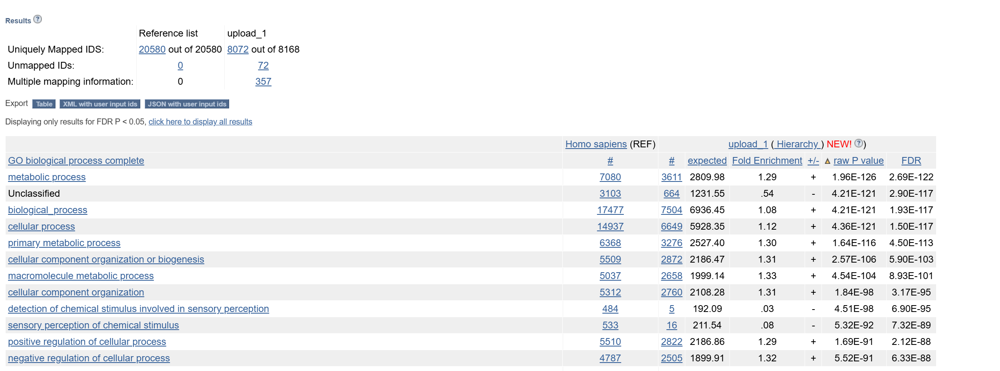

##Input data
```{r}
library(DESeq2)
```

```{r}
metaFile <- "GSE37704_metadata.csv"
countFile <- "GSE37704_featurecounts.csv"
colData = read.csv(metaFile, row.names=1)
head(colData)
```

```{r}
countData = read.csv(countFile, row.names=1)
head(countData)
```
```{r}
countData <- as.matrix(countData[, -1])
head(countData)
```
```{r}
countData = countData[rowSums(countData) > 0, ]
head(countData)
```

## Running DESeq2
```{r}
dds = DESeqDataSetFromMatrix(countData=countData,
                             colData=colData,
                             design=~condition)

dds = DESeq(dds)

dds
```

```{r}
res = results(dds)

summary(res)
```


##Volcano plot

```{r}
library(ggplot2)
ggplot(res) +
  aes(x=log2FoldChange,
      y=-log10(padj)) +
  geom_point()
```
>Q. Improve this plot by completing the below code, which adds color, axis labels and cutoff lines:

```{r}
mycols <- rep("gray", length(res$padj))

mycols[res$padj < 0.05 & abs(res$log2FoldChange) > 2] <- "blue"

ggplot(res) +
  aes(x=log2FoldChange,
      y=-log10(padj)) +
  geom_point(color=mycols) +
  xlab("Log2(FoldChange)") +
  ylab("-Log(P-value)") +
  geom_vline(xintercept=c(-2,2)) +
  geom_hline(yintercept=-log10(0.05))
```
```{r}
library("AnnotationDbi")
library("org.Hs.eg.db")

columns(org.Hs.eg.db)

res$symbol = mapIds(org.Hs.eg.db,
                    keys=row.names(res),
                    keytype="ENSEMBL",
                    column="SYMBOL",
                    multiVals="first")

res$entrez = mapIds(org.Hs.eg.db,
                    keys=row.names(res),
                    keytype="ENSEMBL",
                    column="ENTREZID",
                    multiVals="first")

res$name = mapIds(org.Hs.eg.db,
                  keys=row.names(res),
                  keytype="ENSEMBL",
                  column="GENENAME",
                  multiVals="first")

head(res, 10)
```
```{r}
res = res[order(res$pvalue),]

write.csv(res, file="deseq_results.csv")
```


##KEGG Pathway

```{r}
library(pathview)
library(gage)
library(gageData)

data(kegg.sets.hs)
data(sigmet.idx.hs)

# Focus on signaling and metabolic pathways only
kegg.sets.hs = kegg.sets.hs[sigmet.idx.hs]

# Examine the first 3 pathways
head(kegg.sets.hs, 3)
```
```{r}
foldchanges = res$log2FoldChange
names(foldchanges) = res$entrez
head(foldchanges)
```

```{r}
keggres = gage(foldchanges, gsets=kegg.sets.hs)
attributes(keggres)
```
```{r}
head(keggres$less)
```

```{r}
pathview(gene.data=foldchanges,
         pathway.id="hsa04110",
         kegg.native=FALSE)
```
```{r}
## Focus on top 5 upregulated pathways here for demo purposes only
keggrespathways <- rownames(keggres$greater)[1:5]

# Extract the 8 character long IDs part of each string
keggresids = substr(keggrespathways, start=1, stop=8)
keggresids

```
```{r}
pathview(gene.data=foldchanges, pathway.id=keggresids, species="hsa")
```

```{r}

```

## Gene Ontology

```{r}
data(go.sets.hs)
data(go.subs.hs)

# Focus on Biological Process subset of GO
gobpsets = go.sets.hs[go.subs.hs$BP]

gobpres = gage(foldchanges, gsets=gobpsets)

lapply(gobpres, head)
```


## Reactome Analysis

```{r}
sig_genes <- res[res$padj <= 0.05 & !is.na(res$padj), "symbol"]
print(paste("Total number of significant genes:", length(sig_genes)))
```

```{r}
write.table(sig_genes, file="significant_genes.txt", row.names=FALSE, col.names=FALSE, quote=FALSE)

```
###REACTOME

```{r}

```


###GO
```{r}

```

>Q: What pathway has the most significant “Entities p-value”? Do the most significant pathways listed match your previous KEGG results? What factors could cause differences between the two methods?

For Reactome the Cell cycle has the most significant Entities p-value with cell cycle while the previous KEGG result which is GO has the most significant entity with metabolic process. Reactome has less significance than GO because GO P value is much lower. The factors that could cause the differences between the two methods is the way that they incoporate the pathways where GO is more significant.